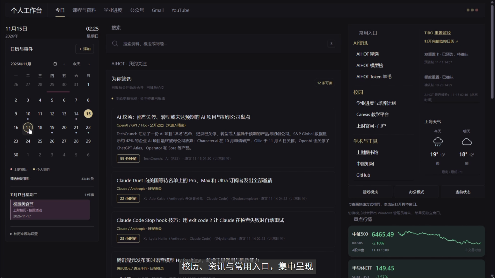
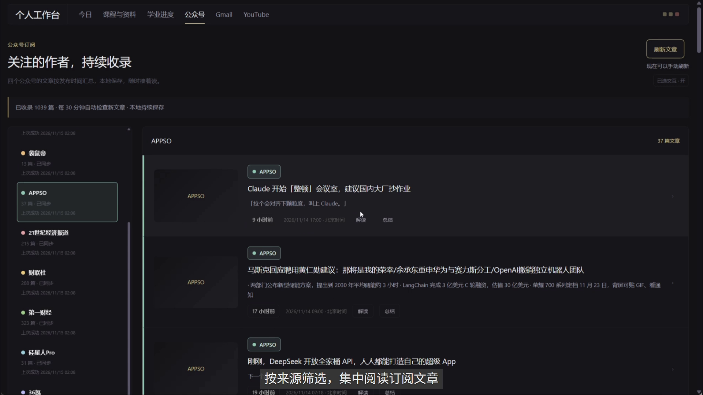
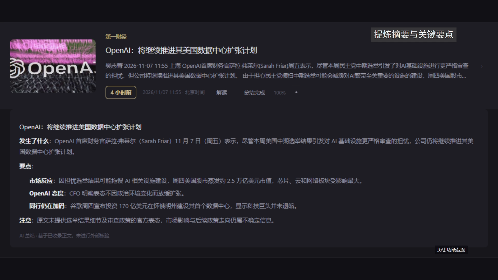
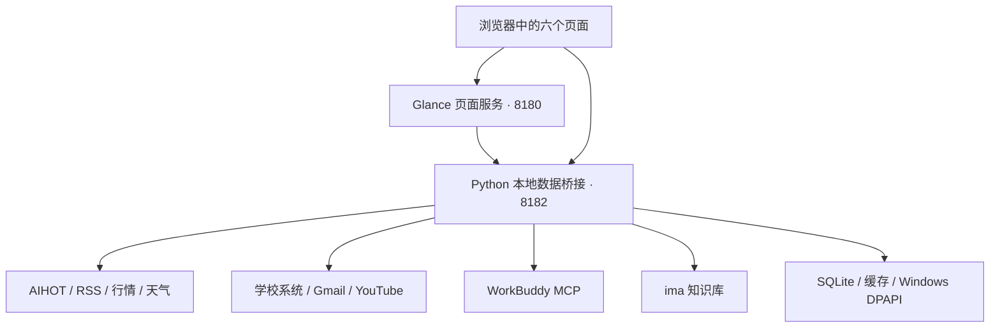

# 个人工作台

把课程任务、关注资讯、订阅文章与多个邮箱放进同一个日常入口，并用 AI 辅助完成文章总结和知识整理。

[](https://gx221015cf.github.io/glance-personal-workbench/watch/)

**[在线播放 68 秒介绍视频](https://gx221015cf.github.io/glance-personal-workbench/watch/)** · [下载原始 MP4](https://raw.githubusercontent.com/GX221015CF/glance-personal-workbench/main/media/workbench-intro.mp4) · [运行说明](docs/RUNNING.md) · [核心案例](docs/CASE-STUDIES.md) · [验证记录](docs/VERIFICATION.md)

视频为 1920×1080、30fps、H.264，无音轨。在线播放页提供浏览器播放控件，原始 MP4 下载入口仍可直接保存文件。画面中的资讯、行情、课程和连接状态对应录制时点，Gmail 与 YouTube 邮箱使用演示信息。AI 总结和 HTML 解读镜头已标注为历史功能截图。[媒体来源与处理记录](docs/MEDIA.md)

## 为什么做这个工作台

查看课表、处理作业、阅读公众号、切换邮箱和保存资料，原本需要在多个系统间来回操作。我从自己的日常需求出发，基于开源 Glance 搭建统一入口，逐步接入本地数据桥接和第三方服务，再根据实际使用反馈调整信息层级、操作路径和异常提示。

这个项目也记录了我的 AI 辅助开发实践。本人承担需求梳理、产品与交互决策、系统集成、使用验收和迭代反馈，借助 Codex、Claude Code 等工具完成代码实现和问题排查。

## 六个页面

| 页面 | 可以完成的事 |
|---|---|
| 今日 | 查看校历、个人安排、AI 关注资讯、天气与重点行情 |
| 课程与资料 | 按课程查看课表、考试、作业和文件，将选中的资料保存到 ima |
| 学业进度 | 查看培养要求、固定计划与学校学业结果，保留来源与同步状态 |
| 公众号 | 按来源集中阅读文章，生成简短总结或结构化 HTML 解读 |
| Gmail | 汇总多个账号的收件箱元数据，筛选账号和未读邮件，进入原邮箱阅读 |
| YouTube | 汇总订阅频道的新视频，按频道、时间和关键词查找 |

本地运行采用空授权状态。公开资讯、行情与天气在联网模式下读取，个人功能需要读者自己的授权和外部服务配置。

## 核心案例 · 从收录文章到 AI 解读



1. 从公开 RSS 订阅定时获取文章，用稳定标识去重，保存到 SQLite。
2. 点击文章，在本地阅读已经收录的正文与配图，也可主动进入微信原文。
3. 根据阅读需求选择简短 Markdown 总结，或更完整的 HTML 解读。
4. 后台向 WorkBuddy MCP 提交任务，页面显示阶段进度，完成后打开结果。
5. 生成内容经过结构校验和 HTML 清理，再进入阅读页面，保留文章来源和阅读边界。



这条流程逐步加入了任务防重、失败提示、重启后中断标记和结果校验。用户反馈也改变了产品细节，例如将等待反馈放回文章卡片，把短新闻总结与长文解读分开，并改进长文阅读宽度。[查看流程与改进案例](docs/CASE-STUDIES.md)

## 补充案例 · 课程资料进入 ima

课程页将学校来源的文件按课程组织，用户选择知识库和目录、检查批量保存预览，再发起保存。同步过程使用文件指纹和稳定 ID 记录关联，识别重复内容，并在中断或结果不确定时回读核对。

维护版本已有真实小批保存和跨进程恢复记录。2026 年 11 月 12 日的一份课程作业保存记录完成了目标目录回读。展示版本通过合成夹具验证同步规则和异常路径，个人课程、云端文件和授权由使用者单独接入。[完成范围与证据口径](docs/CASE-STUDIES.md)

## 实现与个人贡献

Glance **v0.8.7** 提供页面框架、基础组件和布局。自定义部分主要包括 Python 数据桥接、六页中的业务界面、多源适配、授权连接、文章 AI 任务和课程资料同步。Glance 官方程序通过发行包安装。[上游项目](https://github.com/glanceapp/glance) · [使用版本](https://github.com/glanceapp/glance/releases/tag/v0.8.7)



| 关注点 | 本人的工作 | 对应实现 |
|---|---|---|
| 需求与使用路径 | 从学习和阅读场景确定页面与操作优先级 | 六页配置与业务界面 |
| 信息处理 | 定义关注词、去重、来源时间和刷新行为 | 资讯过滤、缓存与局部更新 |
| AI 任务 | 定义输入、输出形式、等待反馈和阅读方式 | MCP 任务、总结、HTML 解读 |
| 知识整理 | 明确课程关联、完整同名规则、预览与确认 | ima 同步与恢复 |
| 验收迭代 | 根据本人使用反馈调整交互并核对结果 | 离线回归、HTTP 与历史使用记录 |

技术使用 Python、JavaScript、HTML/CSS、SQLite、OAuth 2.0 / PKCE、RSS、MCP 和 Windows DPAPI。配套组件试验场支持同类比较、参数调整和选用，公众号页面接入了其中的按钮与折叠实现，原有 MIT 许可随代码保留。

### 关键代码

- [本地路由与后台调度](app/bridge.py)
- [RSS 收录、正文清理与 SQLite](app/wechat_bridge.py)
- [AI 解读与任务管理](app/workbuddy_analysis.py) · [文章总结](app/workbuddy_summary.py) · [HTML 报告封装](app/analysis_report.py)
- [课程资料同步](app/ima_course_sync.py) · [ima 页面业务](app/ima_workspace.py)
- [六页配置](app/config/glance.yml) · [公众号界面](app/assets/wechat.js) · [课程资料界面](app/assets/study-ima.js)
- [Google 授权与元数据](app/gmail_bridge.py) · [学校连接协议](app/school_connector/protocol.py)

## 在本地运行

展示版本面向 **Windows 10/11 x64、Python 3.12**。在仓库根目录执行以下命令。

```powershell
python -m venv .venv
.\.venv\Scripts\python.exe -m pip install -r requirements.txt
.\.venv\Scripts\python.exe tools/install_glance.py
.\.venv\Scripts\python.exe run.py
```

打开 <http://127.0.0.1:8180/>。按 Ctrl+C 退出，启动器会停止自己创建的两个进程。端口已被使用时会提示退出。数据默认保存在仓库内 `.local`。

```powershell
# 暂停桥接后台轮询，查看页面结构与未配置状态
.\.venv\Scripts\python.exe run.py --offline
```

Google、学校连接、WorkBuddy 和 ima 的条件、配置方式及失败表现见[运行说明](docs/RUNNING.md)。Electron 桌面入口属于维护项目的另一种使用方式，本次收录范围聚焦浏览器版本。

## 验证与版本

```powershell
npm ci --ignore-scripts
.\.venv\Scripts\python.exe tools/verify.py
```

Node.js 24 用于前端离线回归。验证入口合批执行选定的 Python 与 Node 测试，同时检查配置、相对链接和公开文件清单。页面与 API 的隔离 HTTP 检查使用独立数据目录。[本批实际结果](docs/VERIFICATION.md)

展示版本整理于 **2026 年 11 月 15 日**，代码、文档、截图和介绍视频已经项目作者审阅通过。来源清单记录每个收录文件对应的维护源码及 SHA-256，适配集中在独立存储、8180／8182 端口和启动入口。[源码来源与收录范围](docs/SOURCE.md) · [来源清单](docs/source-manifest.json)

自定义代码按现有权利说明公开展示，统一许可证由项目作者另行选择。第三方组件按各自许可保留归属，媒体中的文章、封面、商标和公开信息保留其原有权利归属。[许可与素材说明](THIRD_PARTY_NOTICES.md)
