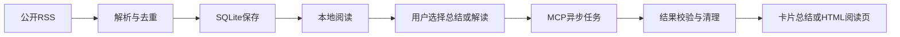

# 使用流程与迭代案例

## 公众号收录与 AI 阅读

输入为公开 RSS 已提供的文章内容。后台解析标题、链接、时间和正文，用稳定文章 ID 去重，并保存到本地 SQLite。阅读页使用清理后的正文及受限图片代理，允许主动打开原文。

用户可选择简短 Markdown 总结或结构化 HTML 解读。任务通过 WorkBuddy MCP 异步执行，卡片显示排队、运行和完成状态。结果经校验、清理和本地报告封装后展示，报告带来源与阅读边界。模型产物中的任意脚本、远程资源与不允许的标签经过限制，报告外壳设置 CSP。

### 从反馈到改进

| 实际使用反馈 | 调整 | 可以核对的入口 |
|---|---|---|
| 点击解读后等待状态不清楚 | 卡片内显示任务阶段，完成后主动打开结果 | `workbuddy_analysis.py`、`assets/wechat.js` |
| 短新闻只需要结论 | 增加独立 Markdown 总结，在文章卡片内展开 | `workbuddy_summary.py`、`assets/wechat-markdown.js` |
| 长文版面过窄、信息密集 | 联合调整提示词、清理器与报告样式 | `analysis_report.py`、`assets/analysis-report.css` |
| 重复点击或启动中断 | 活跃任务防重，启动后标记中断任务并提供重试 | `WorkBuddyAnalysis.recover_interrupted` |

展示版本中的相应测试通过受控 RSS、MCP 客户端和临时目录覆盖成功、失败、重启与内容校验。视频中的总结和解读展示历史产物，生成时点分别保留在画面中。当前机器真实 WorkBuddy 任务未在本批重新发起。

## 课程资料到 ima

学校文件先按稳定课程和文件标识组织。用户关联知识库、选择目录并检查预览，再发起保存。文件内容采用 SHA-256 指纹，结合源文件标识、目标 ID 和完整同名规则判断已保存、待保存或需要核对。

发生部分失败、超时或进程中断时，系统保留操作意图与恢复记录，并通过回读确认目标结果。无法确认时提示核对，用户据结果选择后续动作。

### 已有成果与本批证据

- 维护记录 `glance/docs/ima-stage-b.md`、`glance/docs/ima-stage-c.md` 保存小批真实同步和恢复验收。
- 2026 年 11 月 12 日的课程作业已保存至目标“作业”目录，记录包含完成状态和目录回读。实际文件及映射留在个人环境。
- 维护检查点 #44 记录 2026 年 11 月 14 日的 137 项前端合批检查及正式 HTTP 资源核对，实际间距和窄屏观感仍待用户反馈。
- 展示版本复用选定的 Python 同步测试与 Node 模型／DOM 测试，通过临时文件和合成响应覆盖规则及恢复路径。真实上传和外部目录变更需在使用者自己的接入环境验证。

以上记录用于解释具体完成范围。测试数量表示该批选定的检查项，个人效率、长期使用频率和学习效果尚未形成统一量化记录。

## 交互组件的补充证据

配套试验场在 2026 年 11 月 10 日首版交付中记录 12 类、67 项效果。流程支持同类对比、参数调整、收藏和明确选用，并导出独立实现包。公众号页面使用其中的按钮及折叠实现，复制版本在 `app/assets/components/SOURCE.json` 中记录来源和指纹，MIT 许可位于同目录。

本仓库保留实际接入所需模块。完整试验场与个人收藏记录继续在维护工作区中保存。
