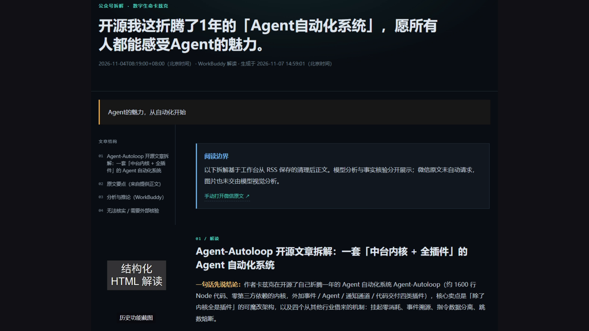
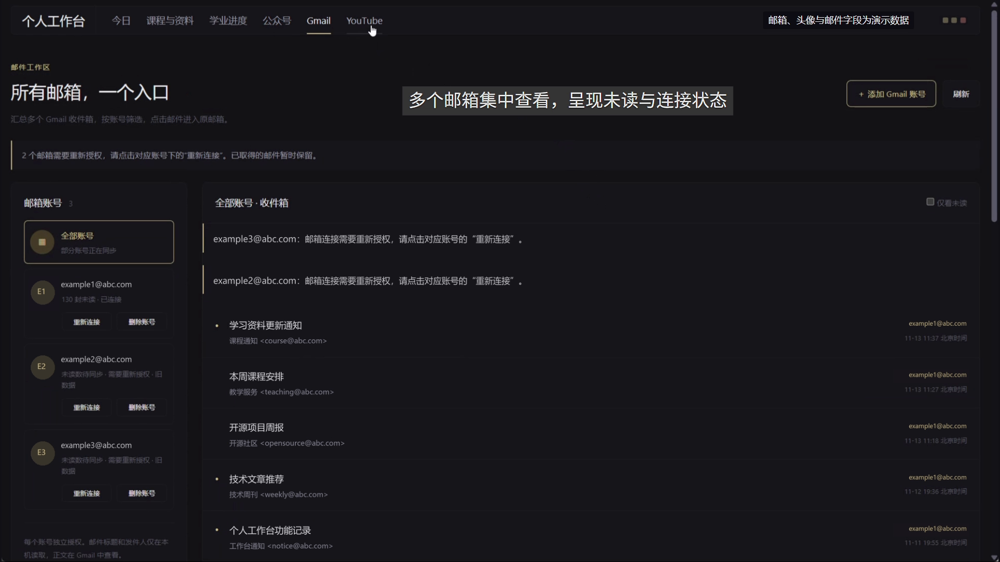

# 图片与视频

## 成片

`media/workbench-intro.mp4` 复制自 Motion 工程的工作台清晰度修订版 v2，原文件名为 `workbench-intro-clarity-v2.mp4`。复制前核对既有交付说明和文件指纹，复制后逐字节指纹一致。

- 68.000 秒，1920×1080，30fps，H.264，yuv420p。
- 3,403,764 字节，静音、无音轨。
- SHA-256 为 `76967856557f4794d92b0a97ba6ca46d573dcd7cbd7251ce5641e807fff5bfc6`。
- 来源制作记录为 `Motion/remotion-sum-demo/out/workbench/v2/DELIVERY.md`，记录 CRF 14、原比例布局、全片解码和 Gmail 连续字段核验。

README 的封面和“在线播放”主入口指向 GitHub Pages 播放页。页面使用 HTML5 video controls，并从同一 Pages 站点加载本仓库的 MP4 和首页截图作为封面。GitHub 原始文件链接保留为次要下载入口，原始文件服务可能以附件方式返回，适合下载后用本机播放器打开。

本地整理阶段再次读取媒体元数据并执行全片解码，审查选用代表帧和六类页面的相应镜头。项目作者于2026年11月15日确认展示初稿内容审阅通过，并授权公开发布现有视频和截图。

## 图片

五张图片均从已经处理的 MP4 直接抽帧，保持 1920×1080。图片数量控制为五张，其余功能通过视频和源码说明。

| 文件 | 成片时点 | 内容与状态 |
|---|---|---|
| `home.png` | 8秒 | 首页与公开校历事件，资讯、行情及天气对应录制时点 |
| `wechat.png` | 33秒 | 公众号来源筛选和已收录文章列表，计数属于录制快照 |
| `summary-history.png` | 37秒 | 历史 Markdown 总结功能截图，画面保留历史标记 |
| `report-history.png` | 43秒 | 历史 HTML 解读截图，保留来源、生成时间和阅读边界 |
| `gmail-demo.png` | 49秒 | 邮箱、头像及邮件字段为演示替换，保留重新授权状态 |

## 画面处理与来源口径

Gmail 中的账号使用 `example1@abc.com` 等稳定演示地址，头像、发件人和邮件标题采用对应替换。YouTube 邮箱同样使用演示信息。课程、学业规划和公开资讯沿用既有视频中作者要求保留的画面，课程与修读统计仍属于作者当时的实际使用快照。

片中两个 AI 结果镜头使用历史截图。公众号的列表计数、行情、天气与资讯均按源画面时点呈现。新启动的独立实例采用空数据根，需要联网同步和个人授权才能形成自己的结果。

源录屏和97项图片资源包保持只读，其余原始账号截图、历史调试图和数据库均未纳入公开清单。视频中的服务标志、文章和视频封面归属见第三方说明。
